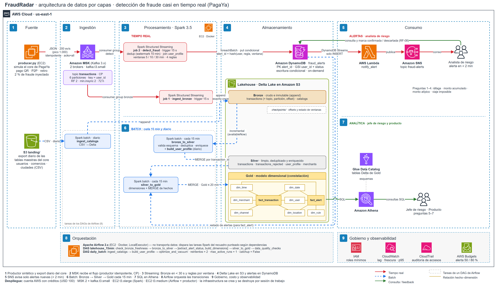

# FraudRadar

Detección de fraude casi en tiempo real para una billetera digital colombiana (caso simulado "PagaYa").
Proyecto final de ST1630 Sistemas Intensivos en Datos, Universidad EAFIT, 2026-2.

Los analistas de riesgo necesitan enterarse de patrones de fraude (ráfagas de transacciones, montos atípicos, viajes imposibles) en menos de 2 minutos. Los jefes de riesgo y el equipo de producto necesitan analítica histórica actualizada cada 15 minutos.



Diagrama editable: [`docs/arquitectura/arquitectura.drawio`](docs/arquitectura/arquitectura.drawio). Los cambios respecto al Entregable 1 están en [`docs/cambios_vs_E1.md`](docs/cambios_vs_E1.md).

## Arquitectura en una línea por capa

| Capa | Componentes |
|---|---|
| Fuente | `producer.py` (transacciones sintéticas con fraude inyectado) · CSV diarios del core en `S3 landing/` |
| Ingestión | Amazon MSK, topic `transactions` (6 particiones, key `user_id`) · job Spark `ingest_catalogs` |
| Procesamiento | Spark Structured Streaming: `ingest_bronze`, `detect_fraud` · Spark batch: `bronze_to_silver`, `build_user_profile`, `silver_to_gold` |
| Almacenamiento | Delta Lake en S3 (Bronze / Silver / Gold en constelación) · DynamoDB `fraud_alerts` |
| Consumo | DynamoDB Streams → Lambda → SNS (alerta al analista) · Athena + Glue Data Catalog (preguntas 5 a 7) |
| Orquestación | Apache Airflow: DAGs `lakehouse_15min` y `daily_batch` |

## Estructura del repositorio

```
├── docker-compose.yml   servicios locales (Spark, Airflow, productor; Kafka local para desarrollo)
├── .env.example         variables de entorno; copiar a .env
├── infra/               crear y destruir la infraestructura AWS de cada sesión
├── producer/            productor sintético y generador de catálogos
├── spark/
│   ├── streaming/       ingest_bronze, detect_fraud
│   ├── batch/           ingest_catalogs, bronze_to_silver, build_user_profile, silver_to_gold
│   └── common/          esquemas y configuración compartida
├── airflow/dags/        lakehouse_15min, daily_batch
├── lambda/notify_alert/ DynamoDB Streams → SNS
├── sql/athena/          DDL y queries de negocio
├── tests/
└── docs/
    ├── entregable1/     PDF y diagrama tal como se entregaron
    ├── entregable2/     slides de la sustentación
    ├── arquitectura/    diagrama vigente
    ├── adr/             decisiones de arquitectura
    ├── estado_del_arte.md
    ├── expo.md          puntos para la exposición
    ├── cambios_vs_E1.md
    └── bitacora_ia.md   bitácora de delegación a agentes de IA
```

## Equipo

| Integrante | Responsable de | Par de defensa |
|---|---|---|
| Mateo García Carreño | Infraestructura, ingestión (MSK, productor, catálogos), `docker-compose.yml`, README | Juan José Vargas |
| Juan José Gómez | Streaming a Bronze y transición Bronze → Silver | Luis Moreno |
| Juan José Vargas | Reglas de fraude, alertas (DynamoDB, Lambda, SNS), `build_user_profile` | Mateo García |
| Luis Moreno Gutiérrez | Gold, Athena, DAGs de Airflow, chequeos de calidad | Juan José Gómez |

Cada PR lo aprueba el par de defensa de quien lo abre.

## Cómo correr el pipeline desde cero

> **Estado:** hoy funcionan la infraestructura, el productor, el aviso por correo y la carga de catálogos a Bronze. Faltan los jobs de streaming (`ingest_bronze`, `detect_fraud`), Silver, Gold, Athena y Airflow; cada paso de abajo dice si ya existe.

### 1. Requisitos

- Python 3.11 o superior, Docker Desktop (con el motor corriendo) y la AWS CLI v2.
- Git Bash en Windows (los scripts son de bash; en PowerShell `bash` puede apuntar a WSL).
- Una cuenta de AWS con el proyecto habilitado en **us-east-2** y su plan pagado (MSK no está en el plan gratuito).

### 2. Configuración

```bash
cp .env.example .env     # completar BUDGET_EMAIL, ALERT_EMAIL y S3_BUCKET
aws login --profile fraudradar
aws configure set region us-east-2 --profile fraudradar
```

### 3. Infraestructura persistente (una vez)

```bash
bash infra/scripts/deploy_persistent.sh     # presupuestos, bucket S3, DynamoDB, SNS y Lambda
```

Confirma la suscripción de correo de SNS (llega un mensaje de AWS) y prueba el aviso con `bash infra/scripts/test_notify.sh`.

### 4. Desarrollo local, sin AWS

```bash
python producer/generate_catalogs.py --users 100000 --out data/catalogs
docker compose --profile local --profile producer up --build      # Kafka propio + productor
bash tests/run_spark_checks.sh                                    # Spark + Delta: ingest_catalogs
python -m unittest discover tests                                 # pruebas de Python (algunas piden boto3)
```

### 5. Sesión en AWS (cobra por hora: MSK y 2 EC2)

```bash
bash infra/scripts/session_up.sh                 # pide confirmación; MSK tarda 20-30 min
bash infra/scripts/test_session.sh               # prueba de humo (7 verificaciones)
bash infra/scripts/producer_aws.sh push          # envía el código a la EC2
bash infra/scripts/producer_aws.sh topic         # topic transactions: 6 particiones, RF 2
bash infra/scripts/producer_aws.sh start 20      # productor a 20 ev/s contra MSK
bash infra/scripts/producer_aws.sh check         # verifica que los mensajes llegan
```

**Al terminar: `bash infra/scripts/session_down.sh`** (borra MSK y las EC2; los datos quedan en S3 y DynamoDB). `bash infra/scripts/session_status.sh` muestra si hay algo encendido y el costo aproximado.

### 6. Lo que falta

`ingest_bronze` y `detect_fraud` (streaming), `bronze_to_silver`, `build_user_profile`, `silver_to_gold`, las consultas de Athena y los DAGs de Airflow. Cuando existan se agregan a este README, y a `docker-compose.yml` los servicios de streaming con `restart: always`.

## Checklist del Entregable 2

- [ ] PR final con todo el código antes de las 11:59 PM del día anterior a S16
- [ ] README con instrucciones para correr el pipeline desde cero
- [ ] `docker-compose.yml` (o equivalente) en la raíz
- [ ] Bitácora de delegación de agentes de IA en `docs/bitacora_ia.md`
- [ ] Slides de la presentación en `docs/entregable2/`
- [ ] El pipeline corre antes de S16 (ensayo obligatorio el día anterior)
- [ ] Cada integrante puede responder preguntas sobre cualquier parte del sistema
